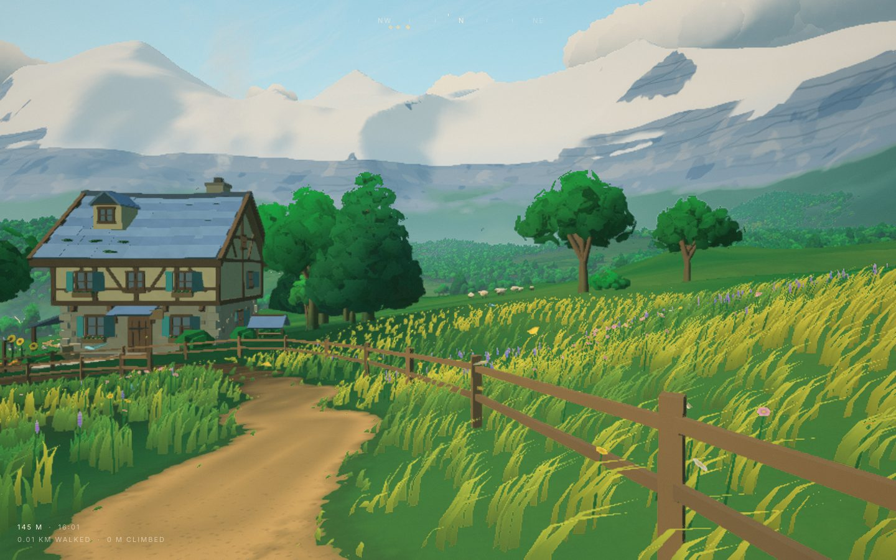
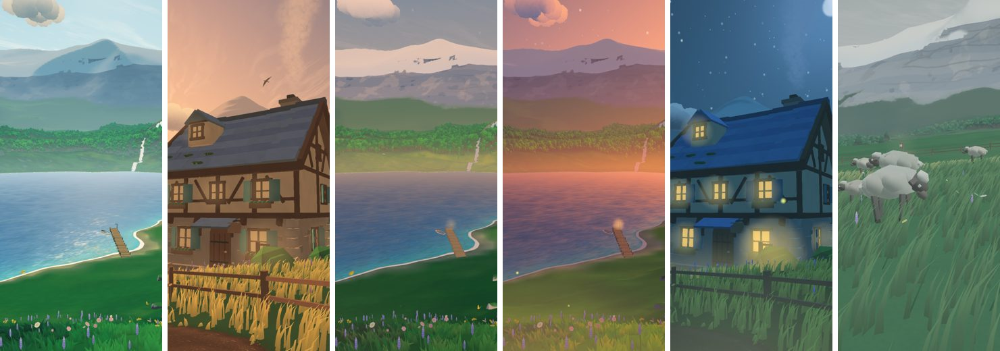
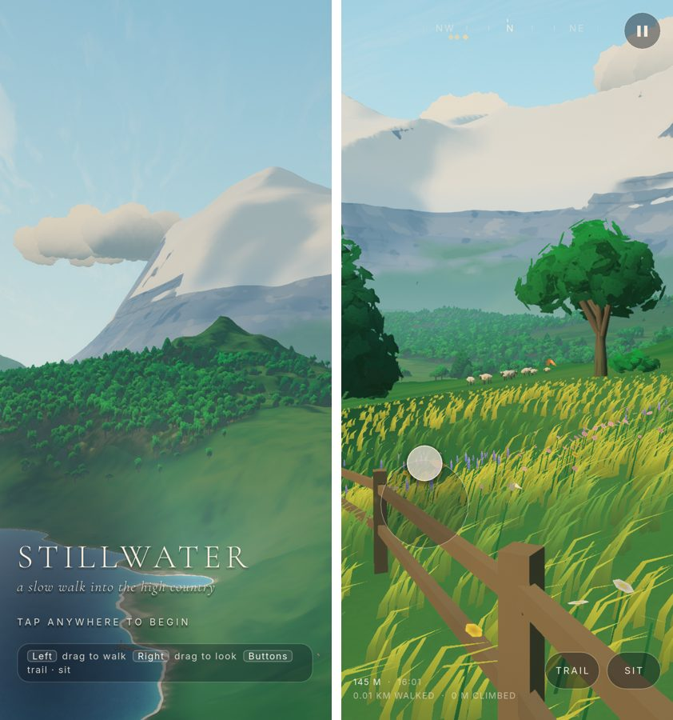

# Stillwater (Godot)

A calm, painterly valley walk, built for the phone. It is a Godot 4 port of the
[Stillwater](https://github.com/tungthedev/stillwater) Three.js demo, and it is becoming the base of a
small exploration game.

**Play it in the browser:** https://stillwater-godot.vercel.app/ (phone or desktop)



## What's in it

- A procedural alpine valley, 4 km walkable with a 32 km backdrop: quadtree terrain, a lake, a stream and
  a waterfall, about 90,000 trees with near, mid and impostor levels, painted meadow grass and flowers,
  forest undergrowth, rocks, a cottage, sheep, birds, butterflies and fireflies.
- Six times of day, colour-graded after Studio Ghibli's *When Marnie Was There*: noon, golden, dawn,
  dusk, night and mist.
- A first-person walk with touch controls (a floating stick on the left, look on the right), a title
  screen, a pause sheet and an ambient soundscape.
- Godot's **Compatibility renderer** only (WebGL2 on the web), so the same build runs in iPhone Safari.
  Native iOS is the long-term target.





## Run it

You need **Godot 4.7** (the project uses the GL Compatibility renderer).

- **Editor:** open `project.godot` and press Play.
- **Web build:**
  ```sh
  godot --headless --export-release "Web" build/web/index.html
  python3 -m http.server 8080 -d build/web   # then open http://localhost:8080/
  ```
  Threads are off, so no special server headers are needed.

## Controls

| | Desktop | Phone |
| --- | --- | --- |
| Start | click | tap |
| Walk | WASD or arrows, Shift to stride | drag on the left half |
| Look | mouse | drag on the right half |
| Follow the trail | Q | Trail button |
| Sit or stand | E | Sit button |
| Pause | Esc | pause button |
| Hide the HUD | H | |
| Perf readout | G | Perf on the pause sheet |

## Useful URL flags

Add them to the page URL on the web (`?tod=dusk&res=50%`), or after `--` on the desktop command line
(`-- --tod=dusk`).

- `?tod=noon|golden|dawn|dusk|night|mist` sets the time of day.
- `?res=auto|100%|50%|40%`, `?dist=100|50|25` and `?dens=100|75|50|25` set render scale, draw distance
  and vegetation density.
- `?nopost`, `?nograss`, `?notrees` and `?shadow` turn single costs off or on.
- `?style=classic` shows the original flat look instead of the painterly one.
- `?bench` runs the fixed benchmark route and shows frame times.

## Speed

On the `low` tier the game runs at about 16-17 ms a frame on an Intel UHD 730 laptop GPU, and it is
tuned for an iPhone 13 mini in Safari. Each system's header comment states its draw-call and triangle
budget, and `tests/frame_budget.gd` checks them.

## Repo layout

| Path | What's there |
| --- | --- |
| `main.gd`, `main.tscn` | start-up: loads the world and creates the systems |
| `systems/` | terrain, grass, trees, water, sky and time of day, post, player, input, HUD, audio, bench |
| `shaders/` | all shaders; `stillwater.gdshaderinc` holds the shared world uniforms and the grade |
| `world/` | loads the baked valley data and answers height, biome and placement queries |
| `data/` | the baked valley (height maps, trees, rocks, sky table, tree meshes) |
| `tools/` | Node scripts: world export, bake, shots, walk checks, benchmark |
| `tests/` | Godot test scripts (budgets, world cross-check, post parity) |
| `web/shell.html` | the web page around the game: safe areas, audio, frame timer |

See [AGENTS.md](AGENTS.md) for how to work on the code.
